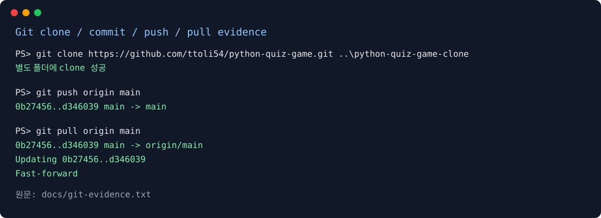
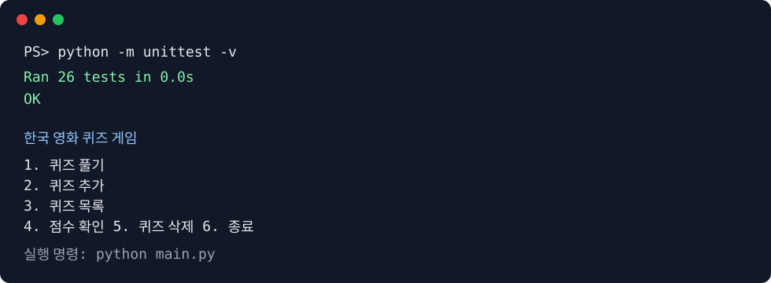

# 한국 영화 퀴즈 게임

Python 표준 라이브러리로 만든 4지선다 콘솔 퀴즈 게임입니다. 한국 영화를 주제로 골라 영화와 감독, 작품 속 배경을 문제로 구성했습니다.

## 주제를 고른 이유

한국 영화는 작품마다 감독·등장인물·시대적 배경이 달라서, 단순한 암기 문제와 배경을 생각하는 문제를 함께 만들기 좋았습니다. 문제를 직접 추가하면서 영화 정보를 다시 확인할 수 있다는 점도 이 과제의 학습 목적과 잘 맞았습니다.

## 실행 환경

- Python 3.10 이상
- 외부 패키지 없음
- Windows PowerShell에서 실행 가능

## 실행 방법

프로젝트 폴더에서 다음 명령을 실행합니다.

```powershell
python main.py
```

테스트는 다음 명령으로 실행합니다.

```powershell
python -m unittest -v
```

실행 중 입력이 종료되면 다음과 같이 현재 상태를 저장하고 안전하게 종료합니다.

```text
입력이 종료되어 현재 상태를 저장하고 안전하게 종료합니다.
```

실행하면 메뉴에서 다음 기능을 선택할 수 있습니다.

1. 퀴즈 풀기
2. 퀴즈 추가
3. 퀴즈 목록
4. 점수 확인
5. 퀴즈 삭제
6. 종료

## 기능 목록

- 기본 한국 영화 퀴즈 6문제 제공
- 문제 순서를 `random.sample()`로 섞어 출제
- 풀 문제 수 선택
- 힌트 보기와 힌트 사용 시 1점 감점
- 새 퀴즈 추가 및 4개 선택지·정답·힌트 저장
- 등록된 퀴즈 삭제
- 최고 점수와 모든 게임 기록 저장
- 빈 입력, 문자 입력, 범위를 벗어난 숫자 재입력
- `Ctrl+C`와 `EOFError` 발생 시 저장 후 안전 종료
- 상태 파일이 없거나 손상된 경우 기본 데이터로 복구

### 사용자 메시지 예시

| 상황 | 콘솔 메시지 |
|---|---|
| 정답 | `정답입니다!` |
| 오답 | `오답입니다. 정답은 2번입니다.` |
| 빈 입력 | `입력값을 입력해주세요.` |
| 숫자 아님 | `숫자를 입력해주세요.` |
| 범위 오류 | `1-4 사이의 숫자를 입력해주세요.` |
| 빈 텍스트 | `입력값은 비어 있을 수 없습니다.` |

## 파일 구조

```text
.
├── main.py       # 프로그램 시작점
├── quiz.py       # Quiz 클래스와 기본 퀴즈
├── game.py       # QuizGame 클래스, 메뉴와 게임 흐름
├── storage.py    # state.json 읽기·쓰기·복구
├── state.json    # 문제, 최고 점수, 게임 기록
├── tests/
│   └── test_quiz_game.py
└── docs/superpowers/
    ├── specs/
    └── plans/
```

## 클래스 역할

`Quiz`는 문제, 4개 선택지, 정답 번호, 힌트를 하나의 객체로 묶습니다. `QuizGame`은 여러 `Quiz` 객체를 관리하고, 메뉴·입력·채점·보너스 기능을 실행합니다. 저장 책임은 `storage.py` 함수로 분리해 게임 흐름과 JSON 형식 검사를 나누었습니다.

주요 공개 메서드는 다음과 같습니다.

| 클래스 | 메서드 | 역할 |
|---|---|---|
| `Quiz` | `display()` | 문제와 선택지를 문자열로 표시 |
| `Quiz` | `is_correct(choice)` | 정답 여부 판정 |
| `Quiz` | `to_dict()` / `from_dict()` | JSON 데이터 변환 |
| `QuizGame` | `run()` | 메뉴와 안전 종료 흐름 실행 |
| `QuizGame` | `play_quiz(quizzes, count)` | 랜덤 출제·힌트·채점·기록 |
| `QuizGame` | `add_quiz()` / `delete_quiz()` | 문제 추가·삭제 및 저장 |
| `QuizGame` | `list_quizzes()` / `show_scores()` | 문제 목록·점수 표시 |

## state.json 설명

파일은 프로젝트 루트에 UTF-8로 저장됩니다.

```json
{
  "quizzes": [{"question": "...", "choices": ["..."], "answer": 1, "hint": "..."}],
  "best_score": 0,
  "history": [{
    "timestamp": "2026-11-07T12:00:00",
    "question_count": 3,
    "correct": 2,
    "hints": 1,
    "score": 1
  }]
}
```

첫 실행에서 파일이 없으면 기본 6문제를 사용합니다. JSON을 읽을 수 없거나 `quizzes`, `best_score`, `history` 구조가 올바르지 않으면 기본 상태로 복구합니다. 프로그램을 종료하거나 문제·점수 기록을 변경할 때 현재 상태를 저장합니다.

### 손상 파일 백업과 저장 안정성

손상된 `state.json`을 발견하면 덮어쓰기 전에 `state.corrupt-YYYYMMDD-HHMMSS-microseconds.json` 형식의 snapshot을 같은 폴더에 남기고 기본 상태로 복구합니다. 백업 성공 여부는 콘솔에 안내합니다. 정상 저장은 먼저 `state.tmp-<uuid>.json`에 기록한 뒤 `os.replace()`로 교체하므로, 저장 중 중단될 때 기존 파일이 부분적으로 덮어써질 위험을 줄입니다. 저장 자체가 실패하면 기존 파일을 보존하고 게임 화면에 오류를 알립니다.

JSON은 `ensure_ascii=False`로 저장해 한글을 그대로 보존하고, `indent=2`로 사람이 읽기 쉬운 형식을 유지합니다.

읽기와 복구 흐름은 다음과 같습니다.

```text
state.json 읽기
├─ 파일 없음                 → 기본 상태로 시작
├─ JSON·스키마 정상           → Quiz 객체로 변환
└─ JSON·스키마 손상           → corrupt snapshot 생성 → 기본 상태 → 안내 메시지

저장: state.tmp-<uuid>.json에 전체 기록 → os.replace() → state.json
```

백업 파일 생성까지 실패하면 원본을 덮어쓰지 않고 기본 상태로 실행하며, 백업 실패 메시지를 표시합니다. 복구가 필요하면 프로그램을 종료한 뒤 남아 있는 `state.corrupt-*.json` 파일을 별도 위치에 복사해 확인하고, 정상 snapshot을 `state.json`으로 복원한 다음 다시 실행합니다.

### JSON 저장 방식의 한계

현재 방식은 매번 전체 상태를 메모리에서 읽고 전체 JSON 파일을 다시 쓰므로, 퀴즈와 기록이 매우 많아지면 파일 크기·메모리 사용량·저장 시간이 함께 증가합니다. 여러 프로세스가 동시에 쓰면 마지막 저장이 앞선 저장을 덮어쓸 수 있고, 조건 검색이나 부분 갱신도 어렵습니다. 규모가 커지면 SQLite를 사용해 기록 테이블을 분리하고, 트랜잭션과 인덱스로 부분 조회·갱신을 지원하는 방향을 고려할 수 있습니다.

현재 저장 정책은 단일 프로세스 실행을 전제로 하며 동시 실행 시 마지막 저장이 우선됩니다. 여러 작성자가 필요한 환경에서는 파일 잠금 또는 SQLite 트랜잭션을 도입하고, 충돌이 발생하면 경쟁 프로세스를 종료한 뒤 snapshot을 확인해 선택한 상태를 복원합니다.

| 경계 | 대표 오류 | 처리 |
|---|---|---|
| 숫자 입력 | 빈 값·문자·범위 초과 | `read_int()`가 오류 메시지 후 재입력 |
| 텍스트 입력 | 빈 문자열 | `_read_text()`가 오류 메시지 후 재입력 |
| 파일 읽기 | 없음·손상 JSON·잘못된 스키마 | 기본 상태로 시작하고 손상 파일 snapshot 생성 |
| 파일 쓰기 | `OSError` | 기존 파일을 보존하고 저장 실패 메시지 표시 |

퀴즈와 게임 기록을 중첩 객체로 저장하는 이유는 한 문제의 `question`, `choices`, `answer`, `hint`를 함께 이동시키고, 한 게임의 `timestamp`, 정답 수, 힌트 수, 점수를 하나의 기록으로 조회하기 위해서입니다. 데이터가 커지면 다음과 같이 SQLite 테이블로 분리할 수 있습니다.

| 요구 | 현재 JSON | 향후 SQLite |
|---|---|---|
| 소규모·사람이 직접 확인 | 간단하고 적합 | 설정 비용이 상대적으로 큼 |
| 부분 조회·갱신 | 전체 파일 재작성 | SQL과 인덱스로 효율적 |
| 동시 쓰기 | 마지막 저장 우선 | 트랜잭션으로 충돌 제어 |

문제 난이도는 현재 요구 범위에 없어 저장하지 않습니다. 향후 추가할 때는 선택적인 `difficulty`(`easy`, `medium`, `hard`) 필드를 `Quiz`, JSON 검증, 테스트, 문서에 함께 반영해야 합니다.

구조는 `main.py → QuizGame → Quiz/storage.py → state.json` 흐름으로 나뉘며, `Quiz`는 문제 도메인, `QuizGame`은 사용자 흐름, `storage.py`는 파일 IO를 담당합니다.

## 테스트

`tests/test_quiz_game.py`는 문제 검증과 JSON 변환, 기본 데이터 6문제, 손상 파일 복구, 메뉴 흐름, 입력 재시도, 안전 종료, 문제 추가·목록·삭제, 랜덤 출제, 힌트 감점, 점수 이력을 확인합니다.

## Git 실습 및 증빙

기능 단위로 커밋하고 `bonus-features` 브랜치에서 보너스를 구현한 뒤 `master`에 병합했습니다. 원격 저장소는 다음과 같습니다.

https://github.com/ttoli54/python-quiz-game

최종 커밋 그래프와 원격 상태는 다음 명령으로 확인합니다.

```powershell
git log --oneline --graph --all
git remote -v
```

로컬 `master` 브랜치를 원격 `main` 브랜치에 업로드했고, 원격 저장소의 초기 README 커밋과도 병합했습니다. 별도 폴더 clone → 변경·commit·push → 원본 pull 실습의 실제 출력은 `docs/git-evidence.txt`에 기록합니다.

Clone/pull 실습 확인 줄입니다.

총 커밋 수는 `git rev-list --count --all`로 확인했으며, 현재는 20개입니다. 커밋 메시지는 `feat`, `fix`, `docs`, `test`, `chore` 접두사를 사용하고 뒤에 변경 목적을 동사형으로 짧게 적습니다. 기능 브랜치는 `git merge --no-ff`로 병합해 통합 시점을 남기고, 병합 전후에 전체 테스트를 실행합니다.

실제 clone·push·pull 콘솔 출력은 아래 시각 증빙과 원문 로그에서 확인할 수 있습니다. 이미지는 실행 결과를 터미널 형태로 정리한 CLI 증빙 이미지이며, 상세 원문은 `docs/git-evidence.txt`에 보존했습니다.





## 변경 요청 시 작업 순서

1. 영향받는 모듈과 설계 문서를 확인합니다.
2. 구현과 함께 관련 테스트를 갱신합니다.
3. `state.json` 스키마나 사용자 안내가 바뀌면 README와 설계 문서를 갱신합니다.
4. `python -m unittest -v`와 `git diff --check`를 실행합니다.
5. 커밋 그래프와 clone/pull 증빙을 갱신하고 원격 `main`에 push합니다.
